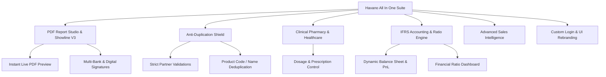

<p align="center">
  
</p>

<p align="center">
  <a href="#-features-overview"></a>
  <a href="#-installation--setup"></a>
  <a href="#-license"></a>
  <a href="#-architecture"></a>
  <a href="#-document--invoice-template-studio"></a>
</p>

---

## 📖 Executive Summary

**Havano All In One** is an enterprise-grade extension suite engineered for **Odoo 19.0** (compatible with both Enterprise and Community editions). It combines high-performance PDF reporting engines, master data anti-duplication shields, clinical pharmacy and healthcare workflows, IFRS-compliant dynamic financial analytics, and comprehensive white-labeling tools into a single, cohesive module.

Designed for production environments where data integrity, regulatory compliance, and brand presentation are mission critical.

---

## 📑 Table of Contents

- [✨ Key Highlights](#-key-highlights)
- [📑 Document & Invoice Template Studio](#-document--invoice-template-studio)
  - [Showline V3 Layout](#showline-v3-layout-flagship)
  - [Supported PDF Template Variants](#supported-pdf-template-variants)
  - [Live In-Browser PDF Preview](#live-in-browser-pdf-preview)
  - [Digital Signatures & Multi-Bank Routing](#digital-signatures--multi-bank-routing)
- [🛡️ Master Data Anti-Duplication Shield](#️-master-data-anti-duplication-shield)
  - [Partner & Contact Rules](#partner--contact-rules)
  - [Product Rules](#product-rules)
  - [Customer vs. Supplier Separation](#customer-vs-supplier-separation)
- [💊 Clinical Pharmacy & Healthcare Engine](#-clinical-pharmacy--healthcare-engine)
- [📊 IFRS Financial Reporting & Ratio Analytics](#-ifrs-financial-reporting--ratio-analytics)
- [📈 Sales Profitability & Inventory Analytics](#-sales-profitability--inventory-analytics)
- [🎨 White-Labeling & Custom Login Builder](#-white-labeling--custom-login-builder)
- [⚡ Operations Automation & Maintenance](#-operations-automation--maintenance)
- [📁 Module Architecture & Code Map](#-module-architecture--code-map)
- [🚀 Installation & Setup](#-installation--setup)
- [📄 License & Authorship](#-license--authorship)

---

## ✨ Key Highlights



---

## 📑 Document & Invoice Template Studio

The PDF Document Studio empowers businesses to replace default Odoo invoice and sales order reports with pixel-perfect, modern corporate layouts.

### Showline V3 Layout (Flagship)
Built from ground-up to deliver an ultra-clean, modern aesthetic:
- **Horizontal Line Dividers Only**: Eliminates bulky dark header blocks and heavy cell borders for a clean and airy layout.
- **Dynamic Field Hierarchy**: Field labels (`Customer`, `Address`, `Phone`, `Order No.`, `Date`, `Sales Person`) are rendered in bold (`font-weight: 700; color: #111827`), while data values are displayed in crisp, non-bold standard weight (`font-weight: 400; color: #374151`).
- **Dynamic Salesperson Info**: Direct phone and email contact details rendered right inside the order box, with automated fallback logic configured per company or per template.
- **Top Header Balance**: Company branding is aligned to the right, balancing the high-resolution logo on the left.

### Supported PDF Template Variants
| Layout Name | Key Design Characteristic | Primary Use Case |
|---|---|---|
| **Showline V3** | Border-line minimalist, bold labels, multi-bank & branch support | Corporate, Engineering, Consulting |
| **Showline V2** | Clean boxed cards, high contrast typography | Logistics & Distribution |
| **Puremetrix** | Technical grid alignment with structured column widths | Manufacturing & Telecoms |
| **Custom Fiscal** | Fiscal compliance elements, tax breakdowns, legal footer | Retail & Fiscalized Markets |
| **Tripple Fresh** | Modern vibrant headers with clean accent dividers | FMCG & Fresh Produce |
| **Trucking** | Delivery dispatch notes, vehicle & container fields | Transport & Fleet Operations |
| **Modern / Normal** | Polished standard formats with customizable accent colors | General Commercial Trading |

### Live In-Browser PDF Preview
Users no longer have to download PDF files to review invoices or quotes:
- **Instant Preview Modal / Drawer**: Triggered straight from the Form view action bar via `preview_button.js`.
- **Zero Roundtrip Delay**: Renders using client-side PDF viewer components directly within the active Odoo webclient session.

### Digital Signatures & Multi-Bank Routing
- **Authorised Signatures**: Upload transparent signature PNGs directly on the company settings or individual layout templates. Signatures render seamlessly on top of the signatory underline.
- **Dynamic Multi-Bank Engine**: Supports single primary bank accounts or dynamic multi-currency banking details listing **Bank Name**, **Branch Name**, **Account Name**, and **Account Number**.

---

## 🛡️ Master Data Anti-Duplication Shield

Redundant records degrade CRM pipelines and corrupt accounting reconciliation. Havano integrates real-time pre-commit deduplication filters:

### Partner & Contact Rules
Configure any combination of validation checks in **Settings → Havano All In One**:
- 🔹 **Exact Name Match**: Flags identical registered company or individual names.
- 🔹 **Email Deduplication**: Rejects or warns when an email is already associated with an existing contact.
- 🔹 **Email + Name Combination**: Allows duplicate names across distinct email domains while preventing duplicate submissions.
- 🔹 **Phone Only / Phone + Name**: Normalizes and checks contact numbers across mobile and landline fields.
- 🔹 **Name + Physical Address**: Distinguishes between branches of the same corporate client.

### Product Rules
- 📦 **Name Uniqueness Check**: Prevents team members from creating identical product catalogue entries.
- 📦 **Internal Reference (`default_code`) Shield**: Enforces unique SKU and barcode codes across products and variants.

### Customer vs. Supplier Separation
- **Sales App Isolation**: Sales dropdowns exclusively populate verified Customers (`customer_rank > 0`).
- **Purchase App Isolation**: Vendor lookups display verified Suppliers (`supplier_rank > 0`).
- **Auto-Graduation**: Automatically marks newly created partners as Customers upon first quote confirmation, or as Suppliers upon purchase order creation.

---

## 💊 Clinical Pharmacy & Healthcare Engine

Havano All In One adds comprehensive clinical product extensions for healthcare, pharmaceutical, and retail dispensary operations:

- **Pharmacy Item Activation**: Toggle pharmaceutical parameters per product template.
- **Dosage Specification System**:
  - Dosage forms (Tablets, Capsules, Syrup, Ampoules, Ointment, Suspension).
  - Strength & potency measurements (e.g., `500mg`, `10ml/5mg`).
  - Unit of Measure (UoM) conversion bridges for dispensing vs. bulk stocking.
- **Prescription & Controlled Substances**:
  - Narcotic & controlled drug categorization.
  - Linked prescriber / doctor verification on sales and distribution lines.
- **API Ready**: Exposes clinical parameters to the Havano Healthcare Mobile and Point-of-Sale API endpoints.

---

## 📊 IFRS Financial Reporting & Ratio Analytics

Elevates Odoo Community and Enterprise reporting to full International Financial Reporting Standards (IFRS):

### 1. Multi-Step Profit & Loss (P&L)
Replaces generic summary P&L with formal commercial accounting structures:
```
1. Revenue (Turnover)
2. Less: Cost of Sales (COGS)
════════════════════════════════════
3. GROSS PROFIT
════════════════════════════════════
4. Add: Other Operating Income
5. Less: Operating Expenses (OPEX)
6. Less: Investing Expenses
7. Less: Financing Expenses
════════════════════════════════════
8. PROFIT FROM CONTINUING OPERATIONS
════════════════════════════════════
9. Gain / Loss from Discontinued Operations
════════════════════════════════════
10. NET PROFIT FOR THE PERIOD
```

### 2. Standardized Balance Sheet
- **Assets**: Categorized strictly into *Non-Current Assets* (Property, Plant, Equipment, Intangibles) and *Current Assets* (Inventory, Receivables, Cash).
- **Equity & Liabilities**: Structured into *Shareholders' Equity*, *Non-Current Liabilities*, and *Current Liabilities*.

### 3. Dynamic Financial Ratio Dashboard
Real-time financial health scorecards:
| Category | Computed Financial Ratios |
|---|---|
| **Liquidity** | Current Ratio, Quick Ratio (Acid Test), Cash Ratio |
| **Profitability** | Gross Margin (%), Net Profit Margin (%), Operating Margin (%) |
| **Solvency** | Debt-to-Equity Ratio, Debt-to-Asset Ratio, Equity Multiplier |
| **Returns** | Return on Assets (ROA), Return on Equity (ROE), Return on Capital Employed (ROCE) |

---

## 📈 Sales Profitability & Inventory Analytics

Real-time visibility into high-performing items, sales reps, and margins:
- 📅 **Daily Sales Reports**: Detailed breakdown of invoice tallies, payment methods, and tax balances aggregated day-by-day.
- 🏷️ **Category Profitability**: Compare gross revenues and margin yields across product categories.
- 🔍 **Item Profitability**: Calculate exact net margins per SKU taking into account discounts, landing costs, and tax deductions.
- 🔄 **Sales Return Tracking**: Real-time auditing of credit notes, refunds, and restocked merchandise.

---

## 🎨 White-Labeling & Custom Login Builder

Transform standard Odoo web interfaces into custom-branded corporate portals:

<p align="center">
  
</p>

### Login Page Personalization
- **Three Layout Orientations**:
  - ⬅️ **Left-Aligned Form**: Minimalist split screen with custom media backdrop.
  - ⏺️ **Center-Aligned Form**: Symmetrical corporate authentication portal.
  - ➡️ **Right-Aligned Form**: Modern SaaS-style hero splash screen.
- **Background Styling**: Support for high-res image uploads, external CDN image URLs, or flat brand hex colors.
- **Home URL Auto-Redirect**: Automatically reroutes any visit to `/` directly to `/web/login`.

### Accounting Menu White-Labeling
- **Rebrand Vocabulary**: Rename standard Odoo labels (e.g. rename "Customers" to "Clients" and "Vendors" to "Suppliers").
- **Granular Menu Masking**: Hide or display individual dropdown entries:
  - Customers dropdown: Invoices, Credit Notes, Payments, Products, Customers.
  - Vendors dropdown: Bills, Refunds, Payments, Expenses, Products, Vendors.

---

## ⚡ Operations Automation & Maintenance

### Global Operations Automation
Set default operational behaviors system-wide:
- **Sales Automation**: Automatically validate delivery orders upon sale confirmation, or auto-generate draft/posted invoices.
- **Purchase Automation**: Automated bill drafting upon purchase order confirmation.
- **Bulk Sync**: One-click action to push automation defaults across all active Odoo user profiles.

### Administrative Database Tools
*Designed for testing, staging, and clean migrations (strictly protected by superuser roles):*
- ⚠️ **Clear All Transactions**: Wipes transaction journals, invoices, and sale records while preserving core master data (products, chart of accounts, customers).
- 🚨 **Clear All Master & Transaction Data**: Complete database sanitization to reset instances before production go-live.

---

## 📁 Module Architecture & Code Map

```text
havano_all_in_one/
├── __manifest__.py                 # Manifest configuration & dependencies
├── hooks.py                        # Post-installation triggers
├── models/
│   ├── invoice_template.py         # Template engine model & design records
│   ├── res_company.py              # Company branding, signatures & multi-bank
│   ├── res_partner.py              # Anti-duplicate engine & contact segregation
│   ├── product_template.py         # Multi-UoM, tax pricing & pharmacy fields
│   ├── pharmacy_dosage.py          # Pharmacy dosage administration
│   ├── account_report.py           # Custom IFRS P&L and Balance Sheet models
│   ├── financial_ratio.py          # Real-time financial ratios engine
│   ├── login_res_config_settings.py# Login page customization parameters
│   └── res_config_settings.py      # Core suite settings configuration
├── reports/
│   ├── showline_v3_layout_templates.xml # Flagship Showline V3 layout
│   ├── showline_v2_layout_templates.xml # Showline V2 layout
│   ├── puremetrix_layout_templates.xml  # Puremetrix technical layout
│   ├── custom_fiscal_layout_templates.xml# Fiscalized invoice template
│   └── report_invoice_templates.xml     # Invoice routing dispatcher
├── static/
│   ├── description/
│   │   ├── havano_banner.svg       # Animated hero banner
│   │   └── icon.png                # Module icon
│   └── src/
│       ├── js/preview_button.js    # In-browser PDF preview handler
│       └── scss/preview_style.scss # Custom preview modal stylesheet
├── views/
│   ├── invoice_template_views.xml  # Template studio backend views
│   ├── res_config_settings_views.xml# Comprehensive settings UI
│   ├── pharmacy_views.xml          # Pharmacy dosage & clinical views
│   └── webclient_templates_*.xml   # Left / Middle / Right login templates
└── security/
    ├── havano_user_roles.xml       # RBAC role declarations
    └── ir.model.access.csv         # Security access definitions
```

---

## 🚀 Installation & Setup

### 1. Prerequisites
- **Odoo**: Version 19.0 (Enterprise or Community)
- **Python**: Version 3.11 or 3.12
- **Required Odoo Core Addons**: `base`, `web`, `contacts`, `product`, `sale_management`, `purchase`, `account`, `stock`

### 2. Installation via CLI
Place `havano_all_in_one` inside your custom addons directory and execute:

```bash
# Update module list and install on target database
python odoo-bin -c odoo.conf -d <your_database> -i havano_all_in_one --stop-after-init
```

### 3. Upgrading to Latest Release
To pull and apply updates:

```bash
# Git pull latest changes
git pull origin main

# Upgrade module schema and views
python odoo-bin -c odoo.conf -d <your_database> -u havano_all_in_one --stop-after-init
```

### 4. Configuration Steps
1. Navigate to **Settings → Havano All In One**.
2. Select your desired anti-duplication sensitivity (Contacts & Products).
3. Set your flagship PDF document layout (e.g., **Showline V3**).
4. Configure digital signatures, bank branches, and custom terms & conditions.
5. Save your preferences and start creating invoices or quotes!

---

## 📄 License & Authorship

- **Author**: Havano
- **License**: LGPL-3 (GNU Lesser General Public License v3.0)
- **Version**: `19.0.1.0.10`
- **Maintained By**: Havano Core Engineering Team

---

<p align="center">
  <b>Built with ❤️ for modern Odoo enterprise deployments.</b>
</p>
